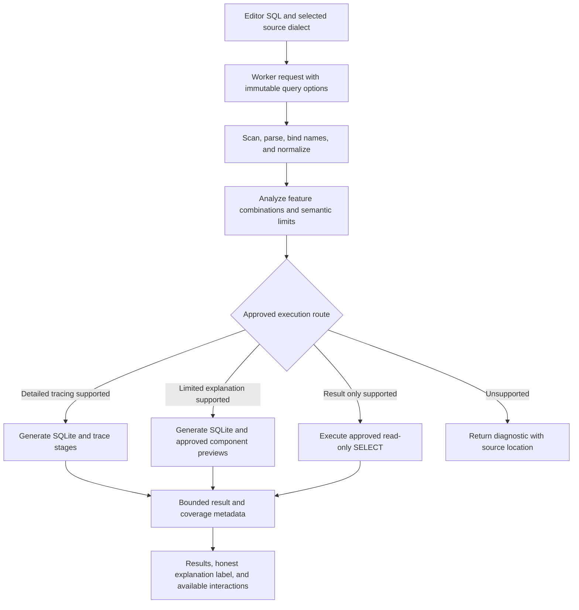

# Browser-only SQL compatibility implementation plan

> Status (Nov 2026): built. See compatibility-review.md for what shipped, the goal criteria and the known gaps.

Planning baseline: October 27, 2026.

Scope: expand useful query compatibility while retaining SQLite/WASM execution in the browser.

## 1. Outcome and boundaries

The goal is to accept more common MySQL, MariaDB, PostgreSQL, SQL Server, and Oracle query spellings, produce correct results for an explicitly supported subset, and explain exactly how much of each query can be visualized.

The application will retain its browser worker, local database, offline execution, recovery checkpoints, and existing lessons. The deployed application will not need vendor database servers. Optional native databases used to verify translations during development are a separate concern.

This project does not promise that every valid vendor query will execute, or that SQLite will reproduce every vendor type, collation, cast, date, numeric, or transaction behavior. A selected dialect describes the source syntax and the compatibility contract; execution still uses SQLite. Existing imported databases have already undergone schema normalization, so selecting another query dialect cannot recover native types or constraints that import discarded.

The first release should deliver:

- Explicit, trustworthy coverage descriptions for existing and new queries.
- A correction to the current treatment of `TOP ... WITH TIES`.
- A dialect preference carried consistently from the editor into the worker.
- A parser/normalization boundary that can preserve advanced SQL constructs.
- Aggregate `FILTER`, named windows, and a defined subset of explicit window frames.
- Accurate results for approved constructs even when detailed tracing is unavailable.
- Tests proving result correctness, accurate coverage labels, and preservation of saved data and lesson progress.

PostgreSQL `DISTINCT ON`, broader `JOIN ... USING`, and recursive CTEs are follow-on milestones. New joined mutation forms, grouping sets, and additional vendor functions are separately scoped extensions.

## 2. What is known about the current implementation

These findings are observations of this checkout, not a claim that proposed features are already supported.

| Area | Current behavior | Consequence for this plan |
| --- | --- | --- |
| Execution | `lib/sqlRuntime.ts` owns a `sql.js` database. | Continue using the existing connection and resource containment. |
| Query translation | `lib/dialect.ts` rewrites supported vendor syntax into SQLite. | New rewrites need explicit semantic contracts and diagnostics. |
| Parsing | `lib/parser.ts` imports the SQLite-only `node-sql-parser` build. | A SQLite feature may execute successfully but still be unparseable here. |
| Serialization | `lib/traceEngine.ts` also imports the SQLite parser and regenerates SQL. | Fixing only input parsing is insufficient; generated intermediate SQL must preserve meaning. |
| Provenance | The tracer appends `_rowid_` and `GROUP_CONCAT` expressions. | Every new operator must be checked for interference from instrumentation. |
| Advanced queries | CTEs, derived tables, and compound queries can show component results followed by a final result. | Reuse this architecture for explicitly limited explanation coverage. |
| Coverage | `QueryRun` currently carries `trace`, `notes`, and optional mutation information. | Add explicit capability/coverage metadata instead of inferring support from a successful result. |
| Editor | `components/CodeMirrorInput.tsx` uses SQLite language support. | Source dialect changes should also update highlighting/completion where supported. |
| Persistence | `lib/persistence.ts` has `STATE_VERSION = 3`; version equality affects curriculum restoration. | A careless settings migration can clear lesson progress or alter the restored bundled schema. |
| Worker protocol | Query requests carry SQL only. | Dialect and execution policy must be captured and transmitted with each request. |

Read-only probes against the installed engine and parser established the following:

| Construct | Bundled SQLite executes it | Installed parser preserves it | Application currently permits it |
| --- | --- | --- | --- |
| Aggregate `FILTER` | Yes | No | No |
| Explicit window frame | Yes | No, for the tested frame query | No |
| Named window | Yes | No | No |
| Recursive CTE | Yes | Yes, for the tested simple recursive query | No |
| `NATURAL JOIN` | Yes | No: the probe became alias `NATURAL` plus an ordinary join | No |
| `JOIN ... USING` with `SELECT *` | Yes | Yes, in the tested simple case | No |
| Aggregate `HAVING` without `GROUP BY` | Yes | Yes, in the tested simple case | No: course validation rejects it |

The existing dialect regression suite completed with 711 checks passed and zero failed during the investigation. Several checks intentionally expect rejection; that number is not a count of fully compatible query forms. The existing fuzz suite generally compares the translated query with SQLite, not with the source vendor engine.

## 3. Proposed architecture



The execution route is selected before running the query. A parser failure, tracing exception, timeout, resource error, or invalid reference must not trigger an automatic retry of arbitrary SQL through a more permissive route.

### Proposed decision A: retain SQLite execution

**Context:** the product's local execution and teaching workflow are valuable, and its current storage/recovery implementation is SQLite-specific.

**Decision:** expand the existing engine's supported subset. Do not add server execution adapters as part of this project.

**Consequences:** deployment and data handling remain familiar; native semantic differences remain part of the published compatibility limits. A different embedded engine would require its own evaluation and would not automatically solve four-dialect compatibility.

### Proposed decision B: separate result semantics from explanation coverage

**Context:** a query can produce a valid translated result while detailed source-row tracing remains unsupported.

**Decision:** track two independent dimensions: the known semantic contract and the available explanation. Do not use a single `supported` boolean.

Suggested internal fields, to finalize during the foundation milestone:

| Field | Purpose |
| --- | --- |
| `sourceDialect` | `legacy`, `sqlite`, `mysql`, `mariadb`, `postgresql`, `sqlserver`, or `oracle`. |
| `compatibilityRevision` | Identifies the rules used for this run, for reproducibility in tests and diagnostics. |
| `features` | Detected feature identifiers, including their scope and source ranges. |
| `semantics` | Distinguishes verified translations within stated limits from explicitly documented SQLite approximations. |
| `explanation` | `detailed`, `components`, or `result-only`. |
| `lineage` | States whether source associations are available and what they mean; allow this to vary by step. |
| `diagnostics` | Structured unsupported-feature, ambiguity, approximation, and instructional messages. |

A label such as “Full trace” must only appear when the implemented trace satisfies its documented contract. The existing row-level source model is not proof of cell-level causality, window-frame membership, or all rows consulted by an expression.

**Consequences:** the result panel and playback controls can tell the truth without rejecting every untraced feature. Existing complex queries must be classified honestly too; do not automatically label all current queries as detailed traces.

### Proposed decision C: centralize parsing, binding, and SQL generation

**Context:** input parsing, string translation, AST validation, SQL serialization, and source highlighting currently have overlapping responsibilities.

**Decision:** put the existing parser behind one adapter and introduce a small normalized query representation for the approved subset. Preserve source SQL, source ranges, executable SQLite SQL, and parser-specific data separately. Route the tracer's serializer through the same boundary.

Start with the current parser and controlled structural normalization. Complete a focused parser spike before feature work: prove round trips for filters, named windows, frames, nested queries, joins, and existing ordered aggregates. If the current grammar cannot represent those features reliably, extend or replace the parser behind the adapter before enabling them. Record that choice and its bundle/license implications; do not grow an unbounded collection of regex substitutions as a substitute for structural parsing.

**Consequences:** this is a contained compiler-front-end refactor, not an attempt to implement every vendor grammar. A parser library accepting a construct does not prove that it serializes it correctly or that SQLite implements the same semantics.

### Proposed decision D: preserve old sessions and contain new execution routes

**Context:** existing sessions accept mixed vendor spellings, and writes have carefully ordered acknowledgment and rollback behavior.

**Decision:** retain an internal `legacy` profile for saved sessions without a dialect preference. Introduce result-only execution for approved read-only SELECT shapes first. Existing DML and CREATE behavior stays on its established atomic execution path.

**Consequences:** new profiles can improve interpretation without silently changing old saved work. No new mutation fallback, arbitrary statement execution, or automatic write retry is introduced.

## 4. Implementation milestones and completion gates

Each milestone is a reviewable change or small group of changes. A later milestone must not depend on an earlier milestone's behavior until its completion gate is met. Relative effort describes scope, not a calendar commitment.

### M0. Freeze the baseline and define the target corpus

**Effort:** small. **Dependencies:** none.

1. Record the current test results, dependency versions, bundled SQLite version, and baseline worker bundle/latency measurements.
2. Gather representative student/course/application queries using fictional schemas. Record the source dialect and relevant settings for each case. Begin with SELECT queries.
3. Split the corpus into existing supported cases, incorrect accepted cases, newly targeted cases, and intentionally unsupported cases.
4. Define correctness for rows, output column names/order, duplicate multiplicity, NULL behavior, ordering, and source-row associations. Treat unordered results as multisets; assert order only when the query defines it. Preserve ambiguity where SQL leaves ties unordered.
5. Record a per-feature contract and combinations that remain unsupported. A feature's support must be evaluated within nested scopes, not just at the outer SELECT.
6. Add targeted regressions for the known parser/semantic failures before changing their handling.

**Files:** `scripts/testDialects.ts`, `scripts/dialectCases/`, `scripts/testTrace.ts`, `scripts/fuzzQueries.ts`; proposed corpus fixtures under `scripts/compatibilityCases/` if they improve organization.

**Gate:** the baseline passes, every first-release target has a concrete expected outcome, and no rejected target has been counted as implemented support.

### M1. Correct known lossy behavior and establish coverage metadata

**Effort:** moderate. **Dependencies:** M0.

1. Add a regression for `TOP ... WITH TIES` containing actual tied boundary values. The current test has no boundary tie and cannot expose the loss of rows.
2. Immediately reject `WITH TIES` with a useful explanation until an exact supported rewrite is implemented. Do not continue converting it to ordinary `LIMIT`.
3. Inventory other approximations, including ignored locking hints and type/date conversions. Audit Oracle `ROWNUM` filtering combined with ORDER BY: a same-scope pre-sort ROWNUM condition is not generally equivalent to a final LIMIT. Narrow or reject unverified shapes and document their known boundaries rather than claiming native equivalence.
4. Add structured coverage and diagnostics to query results. Classify existing detailed traces and advanced component previews separately.
5. Teach the result panel, playback dock, and row interaction code to use coverage metadata. A result-only response may be represented by one final stage for compatibility with the current UI, but its controls and label must reflect the available explanation.
6. Keep errors distinct: unsupported syntax, invalid SQL/references, known semantic mismatch, resource exhaustion, and runtime failure.

**Files:** `lib/dialect.ts`, `lib/sqlRuntime.ts`, `lib/traceEngine.ts`, `lib/sqlWorkerProtocol.ts`, `store/useAppStore.ts`, `components/ResultPanel.tsx`, `components/PlaybackDock.tsx`, `components/SqlEditor.tsx`.

**Gate:** tied results are never silently shortened; existing advanced queries carry truthful coverage; unavailable lineage cannot appear as a successful source-row trace.

### M2. Carry source dialect through the complete query lifecycle

**Effort:** moderate. **Dependencies:** M1.

1. Add the source-dialect type and profile definitions in a proposed `lib/queryCompatibility.ts` or equivalent focused module.
2. Add an accessible editor control. Use a readable label for the legacy mixed-syntax mode, such as “Compatible SQL”; keep the internal name out of the product flow.
3. Default old sessions with no saved value to the legacy profile. Set lesson-specific profiles only when the lesson has been tested under that profile.
4. Snapshot the selected dialect, policy revision, and SQL text when Run is requested. Pass those values through `runQueryInWorker`, request types, worker dispatch, and `SqlRuntime.runQuery` into parsing/translation. Do not read a mutable global dialect later in a queued operation.
5. Changing the dialect invalidates the displayed trace and pending display generation, like changing the SQL. An already completed write must still be acknowledged and persisted even if its old trace is no longer displayed.
6. Persist a validated optional query preference using the existing patch mechanism. Unknown or missing values get the safe default. Do not rebuild or reinterpret the saved SQLite database when this preference changes.
7. Keep schema-import dialect detection separate. Source query preference is not proof of the dialect of the imported schema.
8. Update CodeMirror's language configuration using its existing compartment where an appropriate dialect is available. Keep native-textarea behavior and keyboard shortcuts equivalent. Highlighting does not define execution support.
9. Use the selected profile to choose the approved lexical and translation rules before statement splitting and common normalization, including relevant quote/backslash handling and ambiguous operators. The selector must affect interpretation, not just diagnostics. Document supported SQL-mode assumptions; preserve the existing mixed rules only in the legacy profile.

**Files:** `lib/dialect.ts`, `lib/parser.ts`, `lib/sqlRuntime.ts`, `lib/sqlWorkerProtocol.ts`, `lib/sqlWorkerClient.ts`, `workers/sql.worker.ts`, `lib/persistence.ts`, `store/useAppStore.ts`, `lib/lessons.ts`, `components/SqlEditor.tsx`, `components/CodeMirrorInput.tsx`.

**Migration requirement:** do not simply increment `STATE_VERSION` and reuse the current normalization logic: it treats older versions as an older curriculum. Either add the optional setting compatibly or write an explicit migration preserving `ranLessons`, the last schema, the custom database, drafts, and revision checks. Increment the IndexedDB database version only if its object-store structure actually changes.

**Gate:** old saved sessions and lesson progress survive; SQL and dialect cannot be mismatched by queueing, worker recovery, editing, or schema switches; unavailable persistence still leaves a usable session. A same-text/different-profile fixture proves a chosen quoting or backslash ambiguity is interpreted according to each documented profile, rather than both profiles falling through the unchanged mixed translator.

### M3. Introduce structural normalization and select execution routes

**Effort:** substantial foundation work. **Dependencies:** M2.

1. Introduce one parser adapter, proposed as `lib/queryParserAdapter.ts`, and one feature analysis layer, proposed as `lib/queryCapabilities.ts`.
2. Keep normalized nodes for SELECT scope, projection, ordering, aggregates, filters, window definitions/frames, joins, and CTEs. Add only the nodes needed for released features.
3. Preserve the original SQL and source spans through transformations. Generated helper aliases must be collision-free, excluded from visible output, and mapped back to the user's constructs.
4. Bind tables, aliases, CTEs, and columns against the schema before choosing a route. Retain invalid/ambiguous-column checks; SQLite's permissive quoted-string handling must not turn a misspelled identifier into a successful result.
5. Evaluate features compositionally. Supporting a filter and a window independently does not automatically support a filtered window aggregate; the same applies to DISTINCT, grouping, nested scopes, and set operations. Update every AST visitor to traverse the new nodes, including name validation, physical-table discovery, aggregate/window classification, function notes, date rewrites, source mapping, and SQL generation.
6. Keep SQLite-native syntax that the old parser cannot express in the normalized representation and faithful executable SQL. Parser-only encodings, if retained, must be internal, collision-safe, and restored in every execution fragment.
7. Before execution, classify the approved query as detailed trace, component explanation, result only, or unsupported. Unknown constructs remain unsupported.
8. Implement result-only execution using the bounded row reader and existing worker deadline. Allow only validated SELECTs and SELECT-only CTE bodies; reject additional statements, unapproved functions/objects, PRAGMAs, ATTACH, DDL, and DML through this route.
9. Route all SQL emission through tested adapters, including the serializer in `traceEngine.ts`. Compare emitted SQL with expected semantics rather than checking only that parsing succeeds.
10. Preserve current recovery, cumulative budgets, and operation ordering. Do not retry the query in a fallback mode after any execution or tracing failure.

**Files:** `lib/sqlText.ts`, `lib/parser.ts`, `lib/dialect.ts`, `lib/orderedAggregates.ts`, `lib/traceEngine.ts`, `lib/clauseRanges.ts`, `lib/sqlRuntime.ts`, `lib/resourceLimits.ts`; proposed parser/capability modules.

**Gate:** parse/serialize/execute probes preserve the target semantics; NATURAL JOIN remains blocked until explicitly implemented; nested feature detection works; result-only mode cannot execute a write or bypass limits; old trace behavior still passes its regressions.

### M4. Add aggregate FILTER and named windows

**Effort:** moderate after M3. **Dependencies:** M3.

**Aggregate FILTER implementation:**

1. Preserve the native aggregate filter in executable SQLite SQL. Represent it structurally for validation and explanation. A CASE-based lowering is allowed only for individually verified aggregate forms, not as a generic rewrite of every function.
2. First support grouped/scalar `COUNT`, `SUM`, `AVG`, `MIN`, and `MAX` with one filter expression per aggregate. Add DISTINCT combinations only with dedicated tests. Keep filtered window aggregates gated until the window milestone verifies them.
3. Distinguish `COUNT(*)` from `COUNT(expression)`: the latter still excludes NULL expression values after applying its filter.
4. A filter applies to its aggregate, not to the entire input group or the query's WHERE clause. Different filtered aggregates in one row may have different contributors.
5. Preserve zero versus NULL behavior: an empty filtered count is zero; an empty filtered SUM is NULL. Do not introduce `ELSE 0` where it changes the result.
6. Preserve argument evaluation behavior where a lowering would otherwise evaluate expressions on excluded rows. Keep volatile/exception-producing cases outside a rewrite until demonstrated equivalent.

**Named-window implementation:**

1. Resolve window names within their SELECT scope and preserve definitions in normalized nodes.
2. Release simple named specifications first. Detect unknown/duplicate names. Keep inherited-window chaining gated until its rules are tested.
3. Inline only when the structural transformation preserves the definition; do not substitute names inside literal text or unrelated nested scopes.

**Explanation contract:** results and truthful aggregate/window descriptions ship first. Group membership may still be displayed as group membership, but must not be labeled as the exact contributors to each filtered aggregate. If a mixed projection makes row-level highlighting misleading, use component/result-only coverage or add a tested per-expression source model before enabling that interaction.

**Gate:** counts, empty sums, NULL predicates, multiple differently filtered aggregates, grouping/HAVING, and named-window scopes have exact expected results and honest coverage. Source highlighting identifies FILTER as part of the aggregate expression, not the outer WHERE.

Concrete filter fixture: for `(x, p)` values `(1, 1), (1, 1), (NULL, 1), (2, 0)`, filtering on `p = 1` must produce `COUNT(*) = 3`, `COUNT(x) = 2`, `SUM(x) = 2`, `AVG(x) = 1`, and, when supported, `COUNT(DISTINCT x) = 1`. A group with no qualifying rows remains in the output.

### M5. Add explicit window frames

**Effort:** moderate for results; substantial for exact contributor visualization. **Dependencies:** M4.

1. Begin with aggregate windows over explicit `ROWS` frames and an explicit supported window ORDER BY: `UNBOUNDED PRECEDING`, `CURRENT ROW`, and nonnegative integer PRECEDING/FOLLOWING bounds in valid combinations. No-ORDER frames can be a separate extension.
2. Keep `RANGE`, `GROUPS`, EXCLUDE options, inherited-window combinations, and other unverified frame forms rejected with specific messages until separately tested.
3. Preserve `PARTITION BY`, the complete window ORDER BY, collations, NULL ordering, and the frame. Do not change the default frame for existing queries that omit one.
4. Keep window ordering separate from final output ordering. Adding `_rowid_` as a hidden tie-breaker changes window semantics and must not happen silently.
5. Permit bounded result/component coverage before promising exact frame contributor highlighting. The current per-row provenance associates an output row with its base rows; it does not identify every row in an aggregate's frame.
6. If detailed frame visualization is implemented later, define a separate per-expression frame-source model and a memory budget for it. Test clipping at partition edges, ties, empty frames, and windows computed after grouping.
7. Verify filtered aggregate windows, supported ranking functions, and interactions with grouping independently. Some functions ignore frames or reject FILTER; do not generalize one aggregate rule to every window function.

**Gate:** running totals and moving averages have correct values, final ordering, partition boundaries, and coverage labels; existing implicit-frame queries are unchanged; unsupported frame forms cannot be silently simplified.

Concrete frame fixture: for amounts `10, 20, 30` ordered by unique IDs within one partition, preceding-one/current-row sums must be `10, 30, 50`; unbounded-preceding/current-row sums must be `10, 30, 60`. Do not permit `DISTINCT` window aggregates or `ROW_NUMBER() FILTER (...)` merely because grouped DISTINCT aggregates or aggregate-window filters work. Keep frame-sensitive value functions separately verified.

### M6. Add verified ranked-query rewrites

**Effort:** moderate to substantial. **Dependencies:** M5 and structured source/output metadata.

**SQL Server TOP WITH TIES:**

- Start with integer `TOP n WITH TIES` on a single ordered SELECT using verified nonvolatile expressions. Keep `TOP PERCENT`, DISTINCT, offset combinations, and compound/grouped/window-bearing forms rejected initially. For example, ranking duplicate input before a SELECT DISTINCT can select the wrong distinct rows.
- Compute rank using the original full ordering tuple and filter with `RANK() <= n`. `DENSE_RANK() <= n` is not equivalent when earlier rows tie.
- Keep the original tie-defining ordering; do not add a hidden row identity to the rank expression. Respect the profile's supported NULL ordering and collations.
- Preserve the displayed projection and ordering; strip helper rank columns. Handle `n = 0`, fewer than n rows, ties at the boundary, and multiple ordering expressions.

**PostgreSQL DISTINCT ON:**

- Start with a single ordered, non-grouped SELECT using verified nonvolatile expressions, without aggregate/window interactions, whose DISTINCT ON expressions satisfy the source dialect's ordering requirements. Add those interactions only after their evaluation order is designed and tested.
- Lower to a ranked subquery with `ROW_NUMBER() OVER (PARTITION BY ... ORDER BY ...)`, keep row number 1, and restore the original outer projection/order/limit at the correct stage.
- Apply filtering and row selection in the correct order. Do not push LIMIT below DISTINCT ON. Resolve aliases/ordinals and preserve NULL positioning under the selected profile.
- If the order does not uniquely select a row, disclose the SQL-level nondeterminism; do not invent a deterministic tie-breaker and claim equivalence. Unordered forms can remain unsupported in the first release.

**Gate:** hand-computed boundary-tie and latest-row-per-group fixtures pass; helper names cannot collide with user aliases; output metadata is unchanged; new rewrites begin with limited explanation coverage until their row lineage is verified.

Concrete tie fixture: scores `100, 90, 90, 80` ordered descending must yield three rows for both `TOP 2 WITH TIES` and `TOP 3 WITH TIES`. A dense-rank rewrite would incorrectly include score 80 for the latter case.

### M7. Expand JOIN USING and consider NATURAL JOIN

**Effort:** substantial for general chained/outer joins. **Dependencies:** M3 output binding; M6 is not a semantic prerequisite but is the recommended delivery order.

1. Model a join's output columns as a relation, not merely a list of physical tables. The current nearest-left-table lookup cannot describe every chained join.
2. Start newly enabled shapes with two base tables and INNER/LEFT `JOIN ... USING`, explicit merged-column references, and unqualified `SELECT *`. Preserve existing verified explicit-column USING forms, including other join kinds; correct any existing semantic defects explicitly rather than accidentally rejecting previously supported queries. Keep additional unverified expansions gated.
3. Correctly produce a single unqualified merged column. Preserve qualified `left.*` and `right.*` behavior separately. Outer joins require the correct merged value, and FULL/RIGHT forms need additional coalescing tests before release.
4. Define output column order by the selected dialect's supported contract. PostgreSQL places USING columns first, in USING-list order; blindly returning SQLite's wildcard order is not sufficient. Output order also affects `ORDER BY 1`, derived tables, and INSERT SELECT consumers.
5. Only lower USING to ON when an explicit projection and binding rules preserve merged-column values, qualification, ordering, and names.
6. Add chained joins, self-joins, derived inputs, and RIGHT/FULL forms in separate extensions after relational output binding is proven.
7. Keep NATURAL JOIN rejected until a schema-aware transformation computes common columns and preserves each dialect's output behavior. Schema changes can alter its implicit join keys. Never pass it through the currently misparsing grammar.

**Gate:** result rows, column names/order, ordinals, qualified stars, duplicate join matches, NULL keys, and unmatched outer rows are correct. Source associations include real matched rows and never invent a source for NULL extension.

### M8. Add bounded recursive CTE results, then assess recursive explanations

**Effort:** substantial. **Dependencies:** M3 plus proven worker containment; follows the earlier feature releases.

1. Start with one self-recursive CTE with an explicit output-column list, containing an anchor SELECT and one recursive SELECT linked by UNION ALL, consumed by an outer SELECT. Add recursive UNION/deduplication only as a separately verified extension. Reject mutual recursion, recursive writes, and vendor-specific hierarchy clauses initially.
2. Update CTE name/column resolution to include the self-reference in the recursive body without treating it as a physical table or unknown source. Validate output arity against the anchor and recursive member, and keep other scope and shadowing checks. Query-mode permission must not automatically change the separate schema-import policy.
3. Execute the approved recursive statement through SQLite and initially display a result-only explanation. Existing CTE previews must not accidentally run an unbounded recursive body again.
4. Retain worker termination and checkpoint restoration for nonterminating computation. Retain output/memory limits; a small final result does not imply small recursive work.
5. Do not add hidden depth columns or an arbitrary LIMIT as a generic safety rewrite: those can change duplicate elimination, recursion, and results. If a finer work/depth budget cannot be enforced without changing semantics, keep the deadline as the backstop and reject unsupported workloads.
6. Treat iteration-by-iteration visualization as a later design. Execution scheduling and duplicate semantics vary; a narrated teaching iteration must not be presented as the engine's physical execution order.

**Gate:** finite sequences and fictional hierarchy fixtures return expected results; bad self-references fail; cycles/nonterminating work stop within containment; the next query recovers the last acknowledged database; no repeated previews multiply the work.

### M9. Extend selected mutation forms, grouping sets, and functions separately

**Effort:** feature-dependent; not required for the first release. **Dependencies:** earlier infrastructure and feature-specific design.

- Consider single-target PostgreSQL DELETE USING and MySQL joined UPDATE/DELETE only with clear duplicate-match semantics. A source that matches a target multiple times can make UPDATE behavior ambiguous; reject forms without a proven contract.
- Preserve one execution of each write, savepoint rollback, RETURNING behavior, affected-table snapshots, foreign-key cascades, capacity limits, persistence acknowledgments, and stale-tab conflict handling. Do not send writes through result-only fallback.
- Consider selected ROLLUP/grouping-set forms using explicit branches only after subtotal labels, NULL grouping keys, duplicate semantics, and GROUPING indicators have a design. A UNION ALL rewrite alone does not establish support.
- Add scalar functions individually with defined input types, NULL behavior, Unicode handling, precision, and allocation limits. Date/interval results and PostgreSQL arrays must not be relabeled as equivalent text or JSON without an explicit approximation contract.
- Evaluate aggregate HAVING without GROUP BY as a focused compatibility feature. It currently conflicts with a course rule and with trace SQL generation; decide how lesson guidance and SQL validity are separated before enabling it.

**Gate:** each extension has an independent capability entry and semantic tests. Nothing in this milestone blocks the earlier useful releases.

## 5. Source changes and proposed ownership boundaries

All paths in this section are repository-relative. Proposed modules are suggestions for boundaries, not files already present.

| Responsibility | Existing files | Proposed additions or changes |
| --- | --- | --- |
| Dialect profiles and feature contracts | `lib/dialect.ts`, `lib/compatFunctions.ts` | Focused `queryCompatibility` definitions and structured diagnostics. |
| Parser and normalized model | `lib/parser.ts`, `lib/sqlText.ts`, `lib/orderedAggregates.ts` | Parser adapter and minimal normalized query types; preserve both source and executable forms. |
| Capability planning | `lib/sqlRuntime.ts`, `lib/traceEngine.ts` | Explicit feature-combination analysis before execution. |
| Result execution | `lib/sqlRuntime.ts`, `lib/db.ts`, `lib/resourceLimits.ts` | Approved SELECT-only result route using existing bounded readers. |
| Stage/row explanations | `lib/traceEngine.ts`, `lib/provenance.ts` | Coverage per result/step; later expression-level sources where justified. |
| Source highlighting | `lib/clauseRanges.ts` | Scope-aware source ranges; exclude nested ORDER BY/FILTER from outer clause matching. |
| Requests and recovery | `lib/sqlWorkerProtocol.ts`, `lib/sqlWorkerClient.ts`, `workers/sql.worker.ts` | Immutable dialect/options per request; preserve checkpoint semantics. |
| State and persistence | `store/useAppStore.ts`, `lib/persistence.ts`, `lib/lessons.ts` | Validated preference; non-destructive migration; stale-response invalidation. |
| Editor/results/playback | `components/SqlEditor.tsx`, `components/CodeMirrorInput.tsx`, `components/ResultPanel.tsx`, `components/PlaybackDock.tsx` | Accessible selection, accurate explanation labels, available interactions only. |
| Documentation | `README.md`, `docs/architecture.md`, `docs/development.md`, `components/HelpModal.tsx` | Publish the shipped subset and known semantic limits; avoid whole-dialect claims. |

Before implementing UI or framework changes, follow `AGENTS.md` and read the relevant installed Next.js guides in `node_modules/next/dist/docs/`. The installed `use-client` guide applies to the interactive editor and browser state. Browser SQL execution must stay in the worker rather than being moved into a server component as an incidental refactor.

## 6. Verification strategy

### Meaningful test layers

1. **Translation expectations:** independently known output rows, types/representations, column names/order, NULLs, duplicates, and ordering. Use real boundary cases rather than tests that merely match the implementation's SQL text.
2. **Parser round trips:** original approved SQLite query versus normalized/emitted SQL, including nested scopes, comments, quoted identifiers, literals containing keywords, generated-name collisions, and existing ordered aggregate encodings.
3. **Trace contracts:** verify values at stages and exact source associations where claimed. For result-only/components coverage, assert the absence of unsupported row interactions and misleading statements.
4. **Worker and persistence:** query/dialect snapshot races, edits while requests run, schema replacement, timeouts, checkpoint recovery after a previous write, reload, denied storage, old saved state, and stale-tab conflicts.
5. **Browser behavior:** native editor and CodeMirror, keyboard operation, narrow layouts, playback/pins, coverage messaging, and the existing supported browser matrix.
6. **Native differential checks where needed:** use vendor engines in development/CI to validate selected rewrites whose semantics cannot be established by comparing SQLite with itself. Record exact engine versions, SQL modes, collation, timezone, and fixture DDL. A native harness does not become a deployed application dependency.

Native comparison cases must use equivalent fixture values and declared assumptions. Separate a query-rewrite defect from differences introduced earlier by schema normalization or decimal/date storage. Do not claim fidelity for an untested vendor version, setting, or feature combination.

### Minimum acceptance fixtures

| Feature | Required cases |
| --- | --- |
| TOP WITH TIES | Actual boundary ties; gaps after ties; n=0; fewer than n rows; multiple sort keys; descending/NULL order; projection hides a sort key. |
| FILTER | True/false/NULL predicate; count star versus nullable expression; no matching rows; empty input; SUM/AVG NULL behavior; DISTINCT duplicates; two different filters in one output row; nested scope. |
| Named windows | Repeated use; unknown/duplicate name; same name in nested scope; definition with frame; rejected inheritance until supported. |
| ROWS frames | Running sum; moving average; partition edge clipping; duplicate sort values; NULL arguments; empty/forward frames; final ORDER BY different from window ordering; unsupported RANGE/GROUPS/EXCLUDE. |
| DISTINCT ON | Multiple groups; duplicates; latest-row choice; NULL ordering; alias/ordinal resolution; invalid ordering prefix; LIMIT after selection; nondeterministic ties; helper alias collision. |
| USING | Multi-column keys; output ordering; unqualified merged key; qualified stars; INNER/LEFT unmatched rows; NULL keys; duplicate matches; rejected chained/outer forms until implemented. |
| Recursion | Finite sequence; rooted tree; empty anchor; self-reference names; cycle timeout; large fan-out; successful read after termination; preserved checkpoint. |
| Coverage/persistence | Missing/invalid dialect preference; preserved lesson progress; source SQL highlights; no fabricated lineage; fallback never retries a write or resource failure. |

Add new cases to `scripts/dialectCases/` and `scripts/testTrace.ts`, or introduce focused feature suites when that makes their contracts clearer. Wire new required suites into `package.json` and the existing CI check path. Convert fuzz cases currently marked as “either” to mandatory success/rejection only when their exact outcome is part of the released contract.

### Commands and when to run them

During an individual feature change, run its focused cases plus the existing affected suites. Broaden checks after meaningful integration changes and before a release candidate:

```sh
npm run typecheck
npm run test:dialects
npm run test:trace
npm run test:sequence
npm run test:schema
npm run test:security
```

The existing release gate remains:

```sh
npm run check
npm run audit:release
npm run test:browsers
```

Browser tests require the existing Playwright browser setup. Consult `docs/development.md` for ports and prerequisites. New dependencies must satisfy the repository's existing audit policy. This planning document does not claim that future feature tests or native-engine comparisons have run.

## 7. Further considerations and unresolved decisions

| Consideration | Required treatment / decision point |
| --- | --- |
| Source dialect versus execution semantics | Explain that the database is SQLite. Explicit profiles must not imply complete native validation or runtime fidelity. Define the supported settings per profile during M0/M2. |
| MySQL versus MariaDB | Test and document separately where behavior diverges; do not infer compatibility from a shared family name. |
| Legacy saved work | Retain the current mixed-syntax profile by default. Test preservation of saved bytes, drafts, progress, schema selection, and revision conflict logic. |
| Course restrictions versus valid SQL | Decide which checks are hard execution restrictions and which should become lesson guidance. Keep this decision separate from adding a parser feature. |
| Parser choice | Complete the round-trip spike before enabling features. Evaluate grammar fidelity, maintainability, bundle cost, worker startup, license, and dependency audit results. |
| Source ranges | The existing clause scanner is designed around simple SELECTs. Window ORDER BY, FILTER WHERE, and CTE clauses must not be highlighted as outer clauses. Preserve original spans through lowering. |
| Aggregate/window provenance | Define whether a highlight means group membership, output-row origin, or expression contribution. A filtered aggregate or frame needs more detail than the current row map supplies. |
| Nondeterministic functions | Repeated intermediate execution can change RANDOM/current-time results and expression evaluation counts. Materialize/evaluate once where semantics require it, or use limited coverage for unverified volatile cases. |
| Teaching model versus physical execution | Stages explain logical query operations. Neither a chosen normalization nor a recursion illustration is proof of a vendor optimizer's execution order. |
| Ranking and tie behavior | Preserve all original ordering expressions and collations. Hidden deterministic tie-breakers can change WITH TIES or window results. |
| Duplicate row identity | Do not infer sources by matching visible row values alone. Equal rows may have different origins; self-joins and outer joins need explicit identities and alias binding. |
| Browser memory | Result budgets do not bound all parser/AST/provenance overhead. Avoid quadratic frame-source maps, exponential subtotal expansion, and repeated recursive previews. Measure worst-case fixtures. |
| Existing limits | Retain the 20,000-character query limit, 50,000 join-candidate guard, 50,000 rows per result, cumulative 500,000 cells/8 MiB values, and the current worker deadline unless a separate measured change justifies adjustment. The join guard is a conservative trace policy, not a recursive-work estimate. Any relaxation for result-only execution needs a separately tested cost policy. |
| Runtime limits | Retain the current 10-second query deadline, 15-second schema deadline, 64 MiB SQLite allocation cap, and 16 MiB database bound. Fewer displayed rows do not prove less intermediate work. |
| Correctness under failure | Never display a partial/truncated computation as a complete result. Do not turn resource or recovery failures into successful limited-mode execution. Preserve the last acknowledged database. |
| Large numbers and types | Preserve the existing safe-integer checks. Decimal precision, implicit conversion, timezones, empty strings, arrays, and JSON need explicit boundaries; syntax translation cannot restore lost storage semantics. |
| Feature combinations | Version capability rules and test combinations, not only individual feature flags. Mixed grouping/windows/filters/joins can require a lower coverage level or rejection. |
| Accessibility | Dialect selection and explanation labels must be keyboard/screen-reader usable; unavailable tracing must have a textual explanation and must not rely on color alone. |
| Performance regressions | Compare worker bundle size, initialization, per-query latency, result transfer, and UI interactions with M0. Set measured budgets before accepting parser growth. |
| Privacy and reproducibility | Use fictional fixtures. Do not upload user SQL/schemas to native test services or collect query telemetry as an incidental part of compatibility work. |
| Rollback | Keep capability entries independently disableable and preserve saved database format. A rollback should reject a new feature clearly while reopening existing saved data normally. |

These are implementation decisions to resolve within their milestones. They do not require changes to the application merely to create or review this plan.

## 8. Delivery sequence and definition of done

Recommended review sequence:

| Change set | Content | Completion evidence |
| --- | --- | --- |
| 1 | Baseline corpus, real tie regression, interim WITH TIES rejection. | Correctness bug is contained; existing suite stays green. |
| 2 | Coverage model and honest labels for existing detailed/component results. | Browser checks prove accurate controls, wording, and row interactions. |
| 3 | Dialect preference, immutable worker options, compatible persistence. | Old-state, race, recovery, and lesson-progress tests pass. |
| 4 | Parser adapter, normalized representation, source ranges, capability planner, approved SELECT-only result path. | Structural round trips and containment tests pass. |
| 5 | Aggregate FILTER and simple named windows. | Feature fixtures, interaction tests, and explicit limitations pass. |
| 6 | Supported ROWS frames and filtered-window combinations. | Running-total/moving-average fixtures and coverage checks pass. |
| 7 | Verified WITH TIES rewrite and ordered DISTINCT ON subset. | Boundary cases and selected native comparisons pass. |
| 8 | Relational output binding and two-table USING expansion. | Dialect-specific column/value/order fixtures pass. |
| 9 | Approved recursive CTE result execution. | Finite results, nontermination containment, and recovery pass. |
| 10+ | Additional provenance, joins, DML forms, grouping sets, and functions. | Independent contracts and release gates for each extension. |

The first useful release ends after change set 6. Sets 7-9 can ship independently after their dependencies. Full expression-level/window/recursive provenance is not an implicit requirement for those result capabilities; their published explanation level must remain accurate.

Estimate M0-M3 separately from individual features: parser normalization and coverage/persistence integration are the main foundational uncertainties. Re-estimate after the parser spike using the agreed corpus and measured regressions. Do not promise a percentage of an entire SQL dialect or a fixed completion date without that scope.

A feature is done only when:

- [ ] Its supported dialects, SQL shapes, settings, and combinations are explicit.
- [ ] Its expected rows, columns, ordering, NULL/duplicate behavior, and relevant errors are verified.
- [ ] Its explanation and source-row interactions match the implemented contract.
- [ ] It preserves resource containment, recovery, persistence, and existing lesson behavior.
- [ ] Its focused tests and the required integration/release checks pass.
- [ ] Its capability entry, help text, and developer documentation describe shipped behavior.
- [ ] Unsupported variants fail specifically without silent semantic simplification.

## 9. References

Repository references:

- [Current architecture](architecture.md)
- [Development checks and deployment](development.md)
- [Security and execution boundaries](../SECURITY.md)

Primary SQL references used to check feature semantics; pin the tested vendor versions in the future corpus rather than treating a moving `current` page as a version guarantee:

- [SQLite window functions](https://www.sqlite.org/windowfunctions.html): native window syntax, frames, and function restrictions.
- [SQLite WITH clause](https://www.sqlite.org/lang_with.html): recursive query structure and execution restrictions.
- [PostgreSQL SELECT](https://www.postgresql.org/docs/current/sql-select.html): DISTINCT ON, window definitions, and query ordering.
- [PostgreSQL table expressions](https://www.postgresql.org/docs/current/queries-table-expressions.html): USING joins, merged columns, and output order.
- [SQL Server TOP](https://learn.microsoft.com/en-us/sql/t-sql/queries/top-transact-sql): WITH TIES ordering requirements and boundary behavior.
- [Oracle ROWNUM](https://docs.oracle.com/en/database/oracle/oracle-database/26/sqlrf/ROWNUM-Pseudocolumn.html): row numbering before versus after an ordered subquery.
- [SQLite SELECT](https://www.sqlite.org/lang_select.html): join outputs and native SELECT processing.
- [SQLite behavioral differences](https://www.sqlite.org/quirks.html): storage and SQL semantics that a syntax translation does not automatically reproduce.
